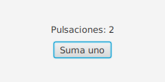
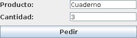

# 01.04 Ventanas

> **Versiones:** Java 25 · JavaFX 27.0.1
> **Conviene saber antes:** [Un proyecto de Maven](02-maven.md)
> **Tiempo estimado:** 1 hora
> **Nivel:** Básico · Ampliación

## Qué aprenderás

- Cómo se hace una ventana con JavaFX.
- Cómo se hace un formulario con Swing.

## 1. Teoría

### 1.1. Una ventana

Una ventana de JavaFX es un `Stage` con una `Scene` dentro.

## 2. Ejemplos de código

### 2.1. Un contador con JavaFX

```java
package es.contador;

import javafx.application.Application;
import javafx.geometry.Insets;
import javafx.geometry.Pos;
import javafx.scene.Scene;
import javafx.scene.control.Button;
import javafx.scene.control.Label;
import javafx.scene.layout.VBox;
import javafx.stage.Stage;

public class ContadorApp extends Application {
    private int veces;

    @Override
    public void start(Stage stage) {
        Label etiqueta = new Label("Pulsaciones: 0");
        Button boton = new Button("Suma uno");
        boton.setId("suma");
        boton.setOnAction(evento -> {
            veces++;
            etiqueta.setText("Pulsaciones: " + veces);
            System.out.println("Pulsado " + veces + " veces");
        });
        VBox raiz = new VBox(10, etiqueta, boton);
        raiz.setAlignment(Pos.CENTER);
        raiz.setPadding(new Insets(16));
        stage.setTitle("Contador");
        stage.setScene(new Scene(raiz, 240, 120));
        stage.show();
    }

    public static void main(String[] args) {
        launch(args);
    }
}
```

📁 **Código:** [`codigo/04-ventanas/ejemplos/2.1-contador/src/main/java/es/contador/`](codigo/04-ventanas/ejemplos/2.1-contador/src/main/java/es/contador/)

Tras pulsar dos veces el botón:

**Salida:**

```text
Pulsado 1 veces
Pulsado 2 veces
```

**La ventana:**



### 2.2. Un formulario con Swing

```java
import java.awt.BorderLayout;
import java.awt.GridLayout;
import javax.swing.JButton;
import javax.swing.JFrame;
import javax.swing.JLabel;
import javax.swing.JPanel;
import javax.swing.JTextField;
import javax.swing.SwingUtilities;

public class Pedido {
    public static JPanel content() {
        JPanel campos = new JPanel(new GridLayout(2, 2, 6, 6));
        campos.add(new JLabel("Producto:"));
        campos.add(new JTextField("Cuaderno", 12));
        campos.add(new JLabel("Cantidad:"));
        campos.add(new JTextField("3", 12));
        JPanel panel = new JPanel(new BorderLayout(8, 8));
        panel.add(campos, BorderLayout.CENTER);
        panel.add(new JButton("Pedir"), BorderLayout.SOUTH);
        return panel;
    }

    public static void main(String[] args) {
        SwingUtilities.invokeLater(() -> {
            JFrame ventana = new JFrame("Pedido");
            ventana.setDefaultCloseOperation(JFrame.EXIT_ON_CLOSE);
            ventana.setContentPane(content());
            ventana.pack();
            ventana.setVisible(true);
        });
    }
}
```

📁 **Código:** [`codigo/04-ventanas/ejemplos/2.2-panel/`](codigo/04-ventanas/ejemplos/2.2-panel/)

**La ventana:**



## 3. Errores típicos

### 3.1. El hilo de la interfaz

La interfaz solo se toca desde su hilo.

## 4. Buenas prácticas

- Pon un id a cada control que quieras encontrar.

## 5. Ejercicios prácticos resueltos

### 🟢 Básico

#### Ejercicio 1 · El id de un botón

¿Con qué método se pone el id de un botón?

<details>
<summary>Pista 1</summary>

Mira el ejemplo 2.1.

</details>

<details>
<summary>Ver solución</summary>

Con `setId`: lo usa el ejemplo [2.1](#21-un-contador-con-javafx).

</details>

### 🟡 Intermedio

Este módulo no tiene ejercicios intermedios todavía.

### 🔴 Avanzado

Este módulo no tiene ejercicios avanzados todavía.

### 🏆 Caso real

Tampoco tiene caso real.

## 6. Chuleta

### JavaFX

| Qué | Clase |
|---|---|
| La ventana | `Stage` |

## 7. Preguntas de repaso

1. ¿Qué hay dentro de un `Stage`?

   <details>
   <summary>Ver respuesta</summary>

   Una `Scene`. Lo tienes en [1.1. Una ventana](#11-una-ventana).

   </details>

---
⬅️ [Anterior: Un proyecto de Gradle](03-gradle.md) · 📚 [Índice](../00-indice.md) · ➡️ [Siguiente: Una aplicación de Spring Boot](05-spring.md)
